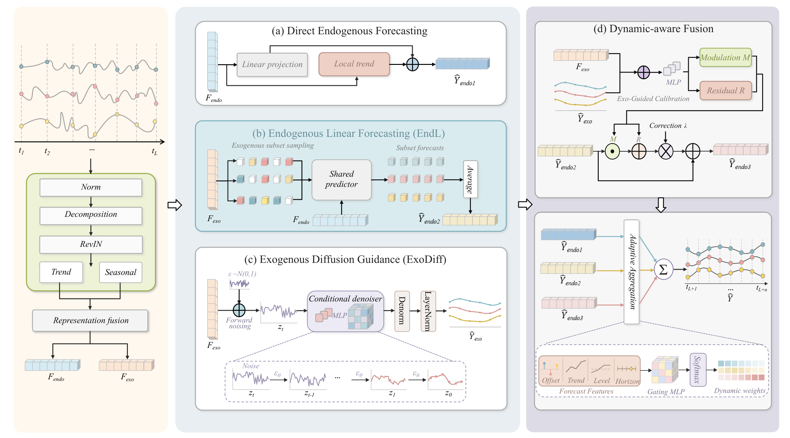

# ExDM

ExDM is a forecasting framework for multivariate time series with explicit
exogenous and endogenous variables. It models target dynamics together with
the future influence of external driving variables.

## Model Architecture

<p align="center">
  
</p>

## Main Work

ExDM forecasts endogenous variables without requiring ground-truth future
exogenous inputs. It separates endogenous and exogenous variables, then uses
RevIN and moving-average decomposition to build trend-seasonal representations.

- **Direct Endogenous Forecasting:** produces a stable prediction from
  historical endogenous variables and local trends.
- **Exogenous Diffusion Guidance (ExoDiff):** transforms historical exogenous
  information into auxiliary guidance aligned with the forecasting horizon,
  rather than directly predicting future exogenous variables.
- **Endogenous Linear Forecasting (EndL):** samples subsets of historical
  exogenous variables and averages their forecasts to obtain a preliminary
  endogenous prediction.
- **Exogenous-guided Calibration and Dynamic-aware Fusion:** calibrates the
  EndL prediction with multiplicative modulation and residual correction, then
  adaptively combines the direct, preliminary, and calibrated predictions.

## Project Structure

```text
models/          ExDM models and forecasting modules
data_provider/   Dataset loading, splitting, and scaling
exp/             Training, validation, testing, and result export
scripts/         Reproducible dataset-specific experiment scripts
tests/           Tests and forecast visualization utilities
results/         Saved prediction arrays
test_results/    Forecast figures
csv_results/     Experiment metrics
checkpoints/     Trained model checkpoints
```

## Installation

```bash
pip install -r requirements.txt
```

CUDA is recommended for training. Custom long-format datasets can be converted
with `preprocess_data.py` before running an experiment.

## Running Experiments

Dataset-specific configurations are provided under `scripts/`. Select the
appropriate dataset script, update its data path when necessary, and run it
from the project root. For example, the available ETT and FR scripts can be
located with:

```bash
find scripts -name 'etth1.sh' -o -name 'FR.sh'
```

The main entry point is `run_longExp.py`. A training run automatically performs
held-out testing and writes:

- `pred.npy`, `true.npy`, and `x.npy` under `results/<run_name>/`;
- metrics under `csv_results/`;
- sample forecast PDFs under `test_results/<run_name>/`;
- model weights under `checkpoints/<run_name>/`.

Sensitivity studies can be launched with `run_sensitivity.py`; the associated
configurations and tests are in `tests/test_sensitivity.py`.

## Visualization

After producing an ETTh1 result with look-back and prediction lengths of 96,
generate the styled forecast PDF with:

```bash
python tests/visualize_exdm_etth1.py --result-dir results/<run_name>
```

The default output is `tests/exdm_etth1_96_96.pdf`.
